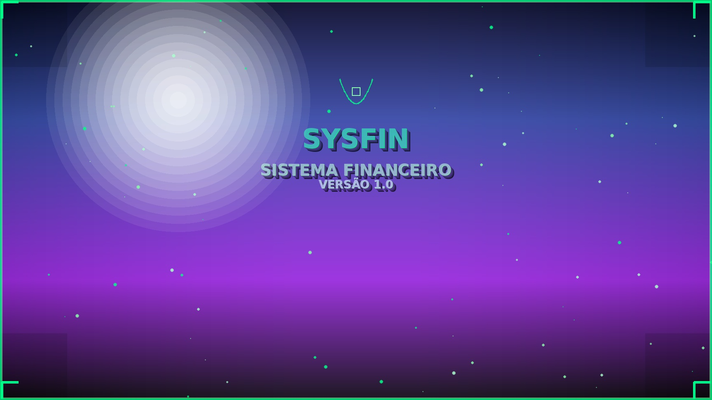

# SYSFIN - Tela de Abertura 3D

Uma tela de abertura moderna e profissional para o **SYSFIN - Sistema Financeiro Versão 1.0** com efeitos 3D e design moderno.



## 📋 Características

- ✨ **Design 3D Moderno**: Efeitos de profundidade e iluminação
- 🎨 **Gradiente Profissional**: Cores azul-roxo com transições suaves  
- ⚡ **Partículas Animadas**: Efeitos visuais dinâmicos
- 📐 **Dimensões Responsivas**: 90% do tamanho da tela (padrão 1728x972)
- 🖼️ **Exportação JPG**: Alta qualidade e otimização
- 🎯 **Texto 3D**: Efeitos de sombra e profundidade
- 🔲 **Bordas Decorativas**: Cantos estilizados e bordas animadas

## 🚀 Versões Disponíveis

### 1. Versão Completa com Interface Gráfica (`sysfin_splash.py`)
- Interface Tkinter interativa
- Animações em tempo real
- Barra de progresso
- Salva automaticamente como JPG ao fechar

### 2. Gerador de JPG Direto (`sysfin_jpg_generator.py`)
- Gera imagem JPG diretamente sem interface
- Ideal para sistemas sem GUI
- Funciona em servidores e ambientes headless

### 3. Versão Simples ASCII (`simple_splash_generator.py`)
- Fallback sem dependências externas
- ASCII art para visualização básica
- Funciona em qualquer sistema Python

## 📦 Instalação

### Requisitos
```bash
# Para versão completa
pip install Pillow

# Para versão GUI (se disponível)
pip install tkinter Pillow
```

### Arquivo de Dependências
```bash
pip install -r requirements.txt
```

## 💻 Como Usar

### Opção 1: Gerador Direto de JPG (Recomendado)
```bash
python3 sysfin_jpg_generator.py
```

### Opção 2: Interface Gráfica Completa
```bash
python3 sysfin_splash.py
```

### Opção 3: Versão Simples (Sem dependências)
```bash
python3 simple_splash_generator.py
```

## 🎛️ Personalização

### Alterando Dimensões
```python
# Em sysfin_jpg_generator.py
generator = SysfinSplashGenerator(1920, 1080)  # Largura x Altura
```

### Modificando Cores
```python
# Cores principais (RGB)
color=(0, 255, 136)      # Verde principal
color=(136, 255, 170)    # Verde claro
color=(170, 255, 204)    # Verde muito claro
```

### Personalizando Texto
```python
# Modificar textos
title = "SEU_SISTEMA"
subtitle = "SEU SUBTÍTULO"
version = "SUA VERSÃO"
```

## 📁 Arquivos Gerados

- `sysfin_splash_screen.jpg` - Imagem final da tela de abertura
- Dimensões: 1728x972 pixels (90% de uma tela 1920x1080)
- Tamanho: ~180KB
- Qualidade: 95% (alta qualidade)

## 🛠️ Estrutura Técnica

### Efeitos Implementados
1. **Gradiente de Fundo**: Transição azul-roxo-escuro
2. **Iluminação 3D**: Fonte de luz radial superior
3. **Partículas Flutuantes**: 80 partículas com movimento matemático
4. **Texto 3D**: 4 camadas de sombra + destaque
5. **Bordas Animadas**: Cantos decorativos estilizados
6. **Logo Simbolo**: Elementos geométricos personalizados

### Tecnologias Utilizadas
- **Python 3.x**
- **PIL (Pillow)**: Manipulação de imagens
- **Tkinter**: Interface gráfica (versão GUI)
- **Math**: Cálculos para efeitos visuais

## 🎨 Paleta de Cores

| Cor | Hex | RGB | Uso |
|-----|-----|-----|-----|
| Verde Principal | `#00FF88` | `(0, 255, 136)` | Título principal |
| Verde Claro | `#88FFAA` | `(136, 255, 170)` | Subtítulo |
| Verde Suave | `#AAFFCC` | `(170, 255, 204)` | Versão |
| Azul Escuro | `#0A1E28` | `(10, 30, 40)` | Fundo gradiente |
| Roxo Médio | `#8C28C8` | `(140, 40, 200)` | Meio do gradiente |

## 🚨 Solução de Problemas

### Erro: "ModuleNotFoundError: No module named 'tkinter'"
```bash
# Ubuntu/Debian
sudo apt install python3-tk

# Ou use a versão JPG direta
python3 sysfin_jpg_generator.py
```

### Erro: "PIL not available"
```bash
pip install Pillow --user
# ou
pip install Pillow --break-system-packages
```

### Problema de Permissions
```bash
# Execute com caminho completo do Python
/usr/bin/python3 sysfin_jpg_generator.py
```

## 📊 Especificações

- **Resolução**: 1728x972 (90% de 1920x1080)
- **Formato**: JPEG de alta qualidade
- **Tamanho Arquivo**: ~180KB
- **Cores**: 16.7 milhões (RGB)
- **Compatibilidade**: Multiplataforma (Windows, Linux, macOS)

## 📄 Licença

Este projeto foi criado para demonstração e uso educacional.

## 👨‍💻 Desenvolvimento

Desenvolvido com foco em:
- Design moderno e profissional
- Performance otimizada
- Compatibilidade multiplataforma
- Facilidade de uso e personalização

---

**SYSFIN V1.0** - Sistema Financeiro com design profissional 🚀 
